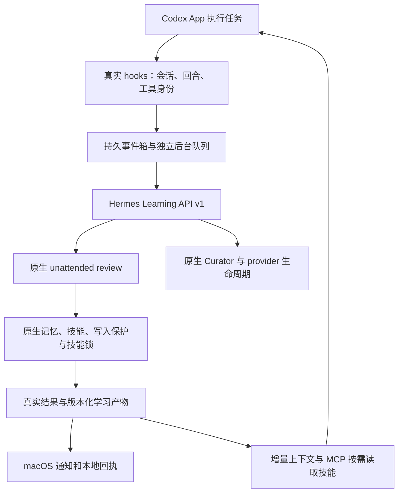

# Codex 执行、Hermes 学习：整体方案

更新日期 2026-11-07。基线为官方 **Hermes v0.22.7 / `b200f5bc60e31588ba2cb60e288029c4a54ba5fa`**，外围插件 **0.2.2**，Learning API **v1**。验收见 [0.2.2 实测记录](./RELEASE-0.2.2.zh-CN.md)和 [验收摘要](../ACCEPTANCE.json)。

## 目标与分工

用户继续在 Codex App 中执行任务。真实 hooks 自动采集执行证据并持久化，后台 Hermes 负责复盘、记忆、技能和维护。用户可从系统通知查看学习回执。后续 Codex 回合通过 hook 上下文及 MCP 获取经验。



| 组件 | 职责 |
| --- | --- |
| Codex App | 业务执行、任务交互和最终业务验证；核心不改 |
| Codex 插件 | hooks 采集、增量反馈、MCP 读取、技能加载指引 |
| 独立后台服务 | 持久队列、投递、去重、空闲补充、通知和发布 |
| Hermes 核心扩展 | `ctx.learning(version=1)`，管理观察会话、原生学习、真实结果与恢复 |
| Hermes 原生机制 | 提示词、模型路由、记忆／技能工具、暂存、审批、技能锁、Curator、provider 收尾 |

## 官方版本与补丁形式

本工程是“官方源码＋可重放学习补丁＋外围插件”。独立运行目录不等于另行维护一套完整 Hermes 发行版，但实际运行代码包含本项目扩展；未修改的官方 App 不能只安装外围插件就获得当前 `ctx.learning` 接口。

核心补丁修改 4 个官方文件，新增 6 个通用学习模块和 4 个测试文件。Codex 专属逻辑保持在外围，核心不导入本项目的队列、通知或 Codex 适配代码。完整 Hermes 源码由官方仓库提供，本仓库保存 [补丁](../patches/native-learning-api-v1.patch)和 [校验清单](../patches/manifest.json)，不包含旧定制版源码或更新器。

当前补丁已在固定官方基线上重放，并核对 14 个文件的完整内容。官方新版本仍需重新检查、重放和回归，不能仅凭版本号增加就承诺兼容。

## 认证复用与数据独立

学习服务使用原生根目录推导和认证回退机制继承已有 Hermes 的 OpenAI 登录。目录入口保留 `root/profiles/entry` 的拼写，指向专用学习数据目录；入口名以点号开头，原生 profile 枚举不会展示它。核心在每次调用中绑定独立的数据目录。

```text
现有 Hermes 根目录
  auth.json                         现有认证库，由原生机制管理
  profiles/.codex-learning-pilot →   独立学习 home（不参与 profile 列表）

独立学习 home
  config.yaml                       新配置，Max、原生 review、独立 gateway
  memories/ skills/ state.db         专用学习数据
  learning/                         v1 journal、发布产物及收据
  bridge/                           事件箱、状态快照、socket 与通知记录
```

不复制 access/refresh token，也不读取 Codex App 的认证文件。刷新由 Hermes 的跨进程锁和源感知回写执行；共享登录的 profile 不各自保存一份会分叉的旋转凭据。外围只调用原生只读认证状态接口，导出不含凭据的字段。

学习 profile 配置 `gateway.standalone: true`，主 gateway 的服务集合排除它，专用 launchd 服务拥有其学习生命周期。现有 Hermes 的配置、记忆、技能和会话不作为新学习 profile 的初始化来源。

后台学习 worker 不作为 Hermes App 的可交互 Bot。旧的可见入口导致过 `Runtime not ready`／`profile_mismatch`，现已改用隐藏入口；真实 App REST 和 Bots RPC 列表均不再返回它，根登录继承和学习数据保持原样。后台命令通过 bridge 绑定运行，不使用 `hermes -p .codex-learning-pilot`。用户继续使用原有 Hermes App profile；[诊断与隐藏记录](./PROFILE-DESKTOP.zh-CN.md)列出原因和范围。

当前部署的数据目录为 `/Users/cy/.hermes-codex-learning/pilot`；隐藏入口为 `/Users/cy/.hermes/profiles/.codex-learning-pilot`。这些是本机部署记录；安装到其他机器时使用 [README](../README.md)中的显式路径参数。旧验收记录中的可见入口属于隐藏前的部署快照。

## 模型配置

```yaml
model:
  provider: openai-codex
  default: gpt-6.1-sol
  api_mode: codex_responses
agent:
  reasoning_effort: max
auxiliary:
  background_review:
    enabled: true
    provider: auto
    model: ""
```

模型和认证属于 Hermes。`auto` 继承这个学习 profile 的模型，并不跟随 Codex App 当前任务模型。使用原生 `codex_responses` 工具循环，使复盘中的记忆和技能工具由 Hermes 执行。更换 provider、endpoint 或模型应通过原生配置完成，并重新验证真实工具调用与写入。

## 自动触发与持久恢复

- 保留原生回合／工具阈值，不将每条事件投递都变成一次模型调用。
- 只按真实 host、project、chat、turn、tool-call 身份计数和去重；缺失身份时记录覆盖缺口，不凭内容相似度猜测工具次数。
- 明确完成且存在未审阅证据时，空闲 120 秒可请求补充复盘；至少间隔 600 秒，并发为 1。
- 长命令仍运行时不视为空闲；同一批证据不因原生阈值和空闲机制重复复盘。
- Curator 保留原生到期与空闲规则，不伪造技能活跃度。

外围事件先落盘再投递。核心 journal 原子保存观察、计数、intent 和 receipt；原生转录以稳定 message UID 投影。执行结果区分 applied、staged、refused、uncertain 与完成状态。

进程在投影或复盘期间退出时，恢复后标为 uncertain／unknown，不盲目重跑。journal、原生 DB、文件和远端 provider 不是一个跨存储事务。关闭执行原生取消、会话收尾与 provider drain；协作取消不表示已经回滚写入。

## 反馈与后续召回

macOS 通知根据真实结果生成，点击打开对应的本地回执。回执列出复盘时间、已应用的操作、等待批准的变更及失败。无新增成果时默认保持静默。历史 0.1.6 的聊天提示另见 [单项目验收](./APP-VALIDATION.zh-CN.md)。

每次 hook 返回的完整 `additionalContext` 最多 256 个 UTF-8 字节，包含标题、项目路径、摘要和 MCP 入口。每个普通字节级 BPE token 至少对应一个字节，因此单次注入最多 256 tokens。Codex 的 `additionalContextLimit` 仍作为宿主溢写设置，宿主消息封装另计。技能正文通过 MCP 按需加载，保留正文、资源哈希、版本和原生 readiness 信息。

模型上下文和系统通知分别记录消费。通知由程序模板生成，避免为通知调用模型或唤醒 Codex。交付正文、实际采用和业务验证各有独立证据。

## 与原生 Hermes 的一致性和差异

复盘由 Hermes 原生 unattended fork 执行，复用其提示词、模型路由、工具白名单、输入预算、写入保护、暂存规则和技能锁。模型产生的技能仍可以继续修订，维护交给原生 Curator。

区别在于业务历史来自 Codex：观察会话需要规范化外部工具结果；Hermes 没有执行主任务，不能保证复用 Codex 的缓存；空闲补充增加了原生阈值之外的触发。Codex 侧提示、技能交付和使用证据由宿主适配负责。这些差异不能被描述为与原生交互完全等价。

v1 支持边界为 macOS／POSIX、in-process 插件、单 home 单 owner。外围 0.2.0 将采集扩展至本机所有项目主聊天，保留各自来源身份；个人知识库共享通用技能，项目记忆按来源范围召回。子 agent、跨机器部署和多 owner 并行尚未验收。

## Tokens 与费用

采集、排队、去重和程序通知不调用模型。额外消耗主要来自跨运行时的缓存差异、空闲补充，以及成果返回 Codex 的输入上下文。原生复盘本就消耗 tokens，不能将其全部算成桥接新增开销。

分开统计来源任务、复盘和其他辅助调用。复盘按 native ledger 计一次。原生阈值和短任务空闲补充均有同任务对照。报告列出各次未缓存输入、缓存读取及输出，订阅的逐任务实付费用保留为未知。[实测用量](./RELEASE-0.2.2.zh-CN.md#同任务成本)

## 已有证据与剩余工作

| 范围 | 已验证结果 |
| --- | --- |
| 官方 v0.22.7 原版相关回归 | 328 项通过 |
| 加补丁后的原生和扩展回归 | 343 项通过 |
| 外围桥接 | 0.2.2 的 38 项通过 |
| 原生完整检查 | 14 项通过，health 无阻断或 advisory |
| 真实 provider | 复用现有登录，6 次原生 review API 调用，新增 1 条记忆、创建并修订 1 项技能 |
| 数据隔离 | 验收时间窗内原 App 437 个记忆／技能文件的元数据指纹一致 |
| 已安装 MCP | 状态、召回、完整技能、版本和内容 hash 通过；重启后 usage 恢复，读取未新增复盘 |

表中的 6 次真实模型调用来自历史隔离探针。App 独立通过单项目闭环及跨项目学习、共享技能交付和项目专属记忆隔离验收。0.2.2 又在实际 App 复验受限摘要和范围召回，并实测 Curator 到期维护、点击通知及两组用量对照。[全局启用记录](./GLOBAL-ROLLOUT.zh-CN.md) · [0.2.2 实测记录](./RELEASE-0.2.2.zh-CN.md)

证据按版本保存在 [evidence](../evidence/README.md)，原始私有运行回执本地保留；公开摘要不携带 live delivery token。历史研究和旧探针列于 [文档索引](./README.md)，不替代当前验收。

## 升级、回退与维护

Hermes 更新先停止本学习服务并保留一致性快照，在新官方稳定版候选中重放补丁，运行原生及插件合同回归，再切换解释器和服务。数据兼容性与回退单独验证，旧运行时在验证完成前保留。

回退学习数据和服务定义时不恢复根账号的旧认证副本，避免回放已轮换 token。Codex 或插件更新后先运行 scripts/check_codex_hooks.py，并在官方界面处理 modified；hooks 文件不变也不能代替信任检查。再验证实际 App hooks 字段、身份、提示和 MCP；核心补丁按 API 行为合同维护，不依赖旧定制版更新器。

本仓库只保存工程与可提交的验证材料。运行时、账号认证、真实学习数据、回退快照与机器私有回执不进入 Git；整体工程推送不等于重新部署或新增 App 验收。
