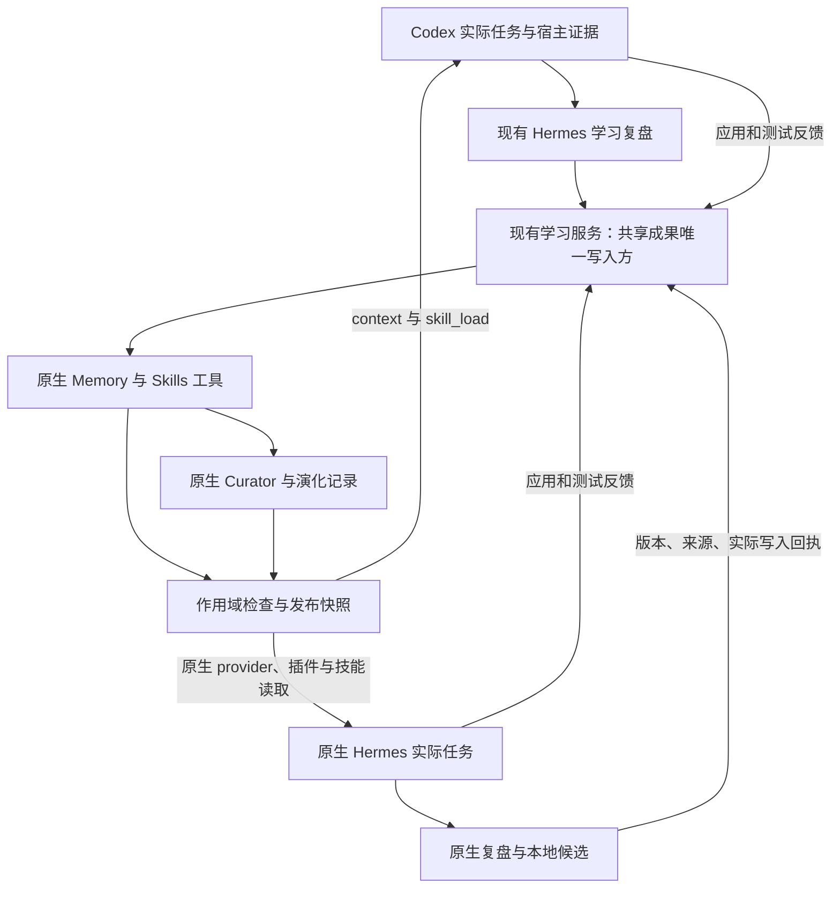

# Codex 与原生 Hermes 自进化成果共享方案

日期：2026-11-15。本文保留实施前的方案。实际接入、使用和回退步骤见[共享学习说明](./SHARED-LEARNING.zh-CN.md)。

目标是让 Codex＋Hermes 和直接使用的 Hermes 都能贡献、读取和纠正同一套适用的经验。共享范围包括技能、长期偏好、项目记忆、案例证据、应用反馈及成果的修订和撤回状态。两个执行 Agent 保留独立运行目录；现有 Hermes 学习服务负责共享成果的权威版本和发布，各端通过原生扩展接口接入。

共享采用三个范围：**同一用户、同一项目、通用方法**。同一项目的事实可以在两种 Agent 间互通；跨项目传播仍按内容的实际适用范围决定。技能正文之外的版本、来源、反馈与失效记录也是必需成果，否则两边只能交换文档，不能共同改进经验。

## 1 实施前基线

本次核对的插件仓库为 `fe0abd3`，外围版本 `0.10.2`。原生安装固定源码为 `3b421578588243f920886e6fe79a6faa87ea026e`，版本 `v0.23.1`；运行中的 learner 使用同一上游基线的私有源码视图和 Learning API 补丁。该 Learning API 属于本项目适配，不能表述为上游无补丁接口。[现有实现说明](./NATIVE-FIRST-OPTIMIZATION.zh-CN.md)

| 已核对项目 | 当前状态 | 对方案的影响 |
| --- | --- | --- |
| 原生数据目录 | `~/.hermes` | 原生记忆、会话及技能仍独立 |
| Codex 学习目录 | `~/.hermes-codex-learning/pilot` | 继续承载共享服务，不另建第三套总结系统 |
| 技能挂载 | 两边 `external_dirs` 均为空，`create_dir` 均为默认 | 尚无自动双向共享 |
| 外部记忆 provider | 两边均未选择 | 可增加本地适配 provider，不必替换已有外部后端 |
| 共享检查 | learner 的 `checked_publication=true` | 沿用版本绑定的发布流程 |
| 学习与整理 | review 已启用；Curator enabled；`consolidate=false` | 当前不能声称模型合并整理已经生效 |
| 当前记忆模型 | 多项目条目共用 learner 的原生文件，再按来源过滤 | 项目记忆容量仍共享一个文件的上限 |
| 当前语义及执行检查 | `semantic_evidence_checks=false`、`quality_checks=false` | 旧内容不能自动获得新方案的来源或执行验证结论 |

以上来自本轮运行中 `learning_status`、`update_status` 和选定配置字段。方案文件不保存私人记忆正文或认证信息。原生能力及源码依据另见[研究记录](./RESEARCH-NATIVE-SHARED-LEARNING-2026-11-15.zh-CN.md)。

## 2 完整共享清单

| 成果 | 应共享的内容 | 范围及承载方式 |
| --- | --- | --- |
| 技能与配套资源 | 流程、前置条件、脚本、模板、参考资料、适用平台、限制 | 通用或项目；沿用原生 `SKILL.md` 与资源包 |
| 稳定用户偏好 | 用户长期明确表达的沟通习惯、常驻要求；保留原话与条件 | 同一用户；常驻事实用原生 `USER.md` 语义，任务类偏好进入相关技能 |
| 项目事实与设计决策 | 项目约束、选型结论及原因、稳定环境事实、验收约定 | 同一项目；拟议项目专属 store 中的原生 `MEMORY.md`，额外绑定项目、主机或分支条件 |
| 纠错与失败教训 | 哪种做法失败、原因、适用条件、替代方案、用户纠正 | 写回相应技能或记忆；失败案例不直接扩大成全局禁令 |
| 经验案例及证据入口 | 解决过什么问题、执行条件、结果、出处和覆盖缺口 | 同项目优先；原生会话检索＋已有 observation/journal 来源引用，按需读取 |
| 使用及验证反馈 | 推荐、加载、采用声明、测试结果、用户反馈、平台与版本 | 精确到成果版本；复用原生 usage，补齐跨宿主结果证据 |
| 演化关系与管理状态 | related_skills、别名、合并、被替代、保护、过期、归档、恢复 | 跟随对应成果范围；原生 frontmatter、Curator、ledger 与 archive |
| 发布及撤回决定 | 哪个版本允许在哪些范围读取，拒绝原因、撤回和删除标记 | 与正文、完整资源清单、来源绑定；扩展现有发布元数据 |

案例摘要是检索入口，不能代替执行证据；来源只是一段材料时，不能标为实际做过。文档和参考资料首先作为技能资源或证据链接管理，避免再建立一套重复知识文档库。

运行进度、临时 TODO、当前终端、未完成工具调用和恢复状态留在所属会话。凭据、模型选择、工具权限、自动批准规则、系统提示与人格文件不作为学习成果自动传播；有关工作方式的经验可以进入有范围的技能。

## 3 目标结构与所有权



继续使用 `pilot` 服务作为共享写入方。它持有共享技能的工作版本、已发布版本、作用域索引和跨端反馈。原生 Hermes 的本地复盘可以产生候选，候选提交后由该服务调用原生工具接纳、修订和发布。源端的本地候选与公共版本各有身份；已共享版本的进一步修改必须携带其基准版本。

每份共享成果只设一个权威写入方。共享技能由一个 Curator 整理，记忆通过原生 Memory 工具和复盘维护；Curator 不承担记忆整理。原生端仍可维护未纳入共享的本地技能。共享成果的修订请求经持久队列串行处理，两端均通过相同的发布视图消费。

原生任务已经形成可核验产物时，上报产物及其依据；不为了同步再对整段对话调用一次总结模型。确需解决语义冲突时才进入原生复盘，使用已有预算和来源约束。重复上报、镜像读取和同步事件不会增加新的学习次数。

## 4 尽量复用的 Hermes 原生机制

| 能力 | 复用的原生机制 | 仍需补齐的桥接职责 |
| --- | --- | --- |
| 学习 | 原生后台 review、Memory/Skills 工具、预算与写入保护 | 原生端产物出口、项目归属、事件去重 |
| 长期记忆 | `MemoryStore`、`memory` 批次、条目匹配、待审修改 | 用户/项目路由、跨端稳定条目 ID 和已发布视图 |
| 原生记忆消费 | `MemoryProvider.initialize/prefetch/on_memory_write` | 本地共享 provider，连接现有学习服务 |
| 技能消费 | `skill_view`、原生技能索引、可选 `external_dirs` | 只交付已发布版本、来源身份、实际写入保护 |
| 历史查找 | `session_search(profile=...)` 与指定 profile 的数据库 | 项目过滤、跨源聚合、原文展开权限与去重 |
| 整理和恢复 | Curator、usage、related_skills、ledger、archive/restore | 跨端使用活动汇入、发布别名、撤回同步 |
| 运行证据 | 原生 `post_tool_call`、`on_skill_lifecycle` 等 hook | 关联真实 session/turn/tool、退出结果和交付版本 |
| 展示 | 原生 journey 和已有共享审批页 | 汇总共享状态与来源；区分本地学习和导入成果 |
| 安装升级 | 原生插件/PM 管理与现有候选验证 | 适配能力协商、缺失能力时降级和迁移回退 |

原生机制不具备统一的跨 profile 发布、冲突合并和业务效果证明。源码中的单文件锁、单技能锁及账本不构成跨目录事务。`external_dirs` 下的内容可能被工具就地修改，其写锁和 usage 又属于调用者的 home；仅把两边指向同一目录不能满足共享写入合同。位于 home 外的路径也不能假定适用该 profile 的原生单条 rollback。[原生技能说明](https://hermes-agent.nousresearch.com/docs/user-guide/features/skills)、[研究记录](./RESEARCH-NATIVE-SHARED-LEARNING-2026-11-15.zh-CN.md)

## 5 记忆共享与范围

### 5.1 用户、项目与环境

用户级记忆保存对同一用户持续成立的事实。只在某类任务成立的偏好随技能按需读取。例如“Unity 新项目使用最小空白模板”属于 Unity 工作流约束；它不会因为是用户表达，就被灌入每个无关任务的常驻 USER 记忆。

项目记忆绑定实际聊天工作区，不能用 MCP 进程 cwd、某条终端命令的 cwd 或显示标题推断。初期沿用现有项目身份；确认为同一项目的不同入口建立显式映射。同一 Git remote 不自动等于同一工作区，分支特有结论和机器路径还需记录 worktree/host 条件。没有项目身份的聊天只可取得已允许的用户级与通用内容。

长期记忆同时保留 `observed_at`、依据类型和适用条件。部署状态、安装版本、实时价格等易变事实先回到实际来源核实；过期记忆用作线索。当前用户要求和仓库规则决定当前任务，不被历史经验覆盖。

### 5.2 存储与容量

近期沿用现有来源索引完成按项目的共享读取。完整方案再把用户记忆、各项目记忆分配到独立的原生 MemoryStore，以免所有项目争用一个 2,200 字符池。优先使用由服务管理的隔离 profile 承载这些 store，由同一个服务管理；通用技能仍集中在原 `pilot/skills`。profile 与项目的绑定是新增适配，普通原生 profile 自身没有项目记忆命名空间；管理 profile 是否在桌面隐藏另行验证。

原生 MemoryStore 依赖当前 home，新增的路由必须在隔离调用中绑定正确的原生上下文。首版可采用受控子进程，禁止在并发线程中改写全局 `HERMES_HOME`。profile 创建、Memory 写入、容量控制、批次及修改审批继续使用原生入口。每项目不启动另一个定时学习模型进程。

新增绑定只是存储和路由扩展，不改变原生 Memory 的内容格式或容量判断。摘要达到上限时按原生整理/修改流程处理，详细案例留在检索层。上调字符上限不能替代分层。

### 5.3 原生接入

原生端增加一个薄的本地 MemoryProvider，使用官方的初始化上下文与 recall/write 生命周期，读取现有服务的结构化视图。当前没有已选择的 provider，可以在独立 profile 验证后接入；将来如已使用另一 provider，需要明确替换或由该后端承接，不能假设原生支持并列启用多个外部 provider。

`on_memory_write` 只处理已生效的操作。删除和改写使用原生返回的完整 `previous_content` 对应旧条目，不能把模型传入的模糊 `old_text` 当作身份。固定版本中已经确认：模型 memory 工具执行后有 provider 通知，但 `/memory approve`、journey 记忆编辑/删除、Web memory reset 的直接写入路径没有该通知。[源码调用链核验](./RESEARCH-NATIVE-SHARED-LEARNING-2026-11-15.zh-CN.md)

这些入口与后台 review、手改文件、恢复/导入必须分别验收。reset 默认只表达其原有的本地清空语义；需要撤回共享内容时明确选择相应范围。缺少回执的变动进入待核对；可用确定性指纹对账发现缺口，不能凭差异补造来源或批准。

Codex 端扩展现有 `context`，返回当前用户＋当前项目的已发布记忆。现在的 `context_view` 会清空无范围的 `provider_recall`，应改为消费有明确范围的条目；不能直接透传 provider 的整段召回文本。[现有范围过滤](../src/hermes_codex_learning/knowledge.py)

共享 provider 是候选提交与已发布记忆读取的适配器，不负责另起一个摘要模型。缺少完整写入通知时，补充最小的原生适配回执；优先使用公开插件接口，仍需要核心补丁的部分单列版本合同。

### 5.4 原生本地快照与更新时机

原生 MEMORY/USER 在会话开始时冻结为提示快照。共享版本更新后，下一次 scoped recall 可取得新版本，但已存在于历史提示中的旧内容不会自动消失。[原生记忆行为](https://hermes-agent.nousresearch.com/docs/user-guide/features/memory)

迁移时为本地条目与共享 ID 建立对应关系：相同内容不重复注入；冲突内容展示明确版本及更正依据。转为共享管理的旧常驻条目通过原生修改流程收敛，不能任由旧本地 USER 和新共享偏好长期矛盾。冻结快照通过原生新会话取得更新；是否存在可等价更新快照的重载入口留在 P0 验证，未通过前不承诺旧会话即时生效。

删除或重大纠正优先撤下共享召回，并通知仍持有旧版本的端。历史聊天不能据此宣称已被清除。共享更新生效、旧会话刷新和原文删除是三个分别验收的结果。

## 6 技能发布、反馈与持续改进

### 6.1 技能包

发布对象是完整技能包：主文、参考资料、脚本、模板、文件摘要、依赖及适用条件。正式调用继续使用原生 `skill_view` 或现有 `skill_load`；默认先交付目录摘要，需要时再加载正文和资源。

原生消费端首选通过插件工具访问现有已发布快照；需要融入原生技能目录时再提供 `external_dirs` 的只读发布视图。发布视图不能直接指向 owner 的工作目录。实现必须验证工具写入、后台复盘、终端直写和资源读取的边界，不能用配置名称或提示词代替保护。同一 OS 用户的文件权限不构成强多租户隔离。

技能名、作用域和权威 ID 共同确定身份。挂载前扫描同名本地技能：原生 local 优先于 external，旧本地副本可能遮住共享新版。用明确命名/映射或经核对迁移解除冲突，不默默覆盖。

### 6.2 双向修改

原生写入成功的本地候选经队列上报；Codex learner 的候选走现有路径。服务按 `base_version` 检查修改的公共版本是否仍然一致，然后调用原生工具产生工作版本并记录实际结果。发生并发冲突时保留两份候选及共同基线，交原生复盘或已有审查入口处理，禁止按文件时间直接取最后一份。

共享批准绑定完整内容和作用域；源端“允许写入一个本地技能”不自动意味着“允许跨项目使用”。同样，已发布技能的一次修订不继承旧版脚本测试或旧版数据分类。新候选未通过时，仍获准使用的旧版继续可用；旧版本身被撤回时必须下架。

### 6.3 共同反馈

保留以下不同事实：`recommended`、`loaded`、`applied_claimed`、`host_test_passed/failed`、用户反馈、业务收益。原生 view/use 包含把正文加载进提示，不足以证明实际采用，更不能直接当成功率。现有插件也把采用声明与宿主测试分开。[已有反馈实现](../src/hermes_codex_learning/feedback.py)

原生端用 hook 记录实际加载版本、session、turn、tool_call、执行平台、测试入口及终态；Codex 端沿用宿主证据。为原生事件增加独立 host/source 命名空间，扩展当前 Codex 专用 delivery/feedback 校验，不把 Hermes 事件伪装成 Codex hooks。

跨端相同事件只记一次，镜像导入不计作使用。与当前版本匹配的使用活动可汇入 owner 的原生 usage，避免“另一端一直在用，共享 Curator 却判定无人使用”。历史版本的使用保留原版本身份，不能把 v1 测试结果转给 v2。只有已识别并关联到测试入口的宿主终态才是测试事实，普通命令成功只是执行事实；相关性与业务因果收益另行判断。失败反馈保留环境、依赖及操作条件，按现有失败版本检查和复盘处理，不将一次环境故障概括为方法永久无效。

## 7 共享记录与故障语义

正文继续使用原生格式，只在桥接层增加必要元数据。以下为拟议合同，不是现有工具 schema：

```text
artifact_id / kind / content_version / files_manifest
owner / scope / project_id / user_id / applicability
source_host / source_profile / source_session / source_turn / native_event
parent_version / supersedes / source_artifact_id
publication_state / validation_records / revision / tombstone
```

内容摘要识别版本；稳定 ID 识别条目，避免修改后失去身份。来源、批准范围和验证对象分别保存。个人身份只绑定当前账户/部署已确认的同一用户，不能根据两个聊天显示名字相同就合并。

传输采用持久 outbox/inbox 和至少一次投递，按来源事件 ID、条目 ID 与版本幂等。传播携带原始来源及共享版本回执，防止 A→B→A 被再学为新成果。正文加载、导入事件与新任务证据分开。

一次处理依次记录：准备→原生写入结果→内容读回→发布检查→切换发布版本→消费端确认。崩溃后从原回执恢复；原生可能部分写入，不能用消息处理失败推断全部没发生。未知状态暂停该项发布而不丢弃证据。

发布者生成不可变版本并原子切换索引。单个原生操作的原子性与跨 Memory/Skills/发布库的事务是不同层级；初版按可恢复步骤实现，不宣称跨库原子提交。源码或 hook 不提供的字段明确标为缺失。

服务暂时不可达时，两端继续本地工作，候选入队。缓存附版本、范围及检查时间；过期缓存不自动回退为未发布本地草稿。首次接入没有成功缓存时，继续任务并报告共享不可用。需要严格确认撤回状态的内容在恢复联系前暂停共享读取。

## 8 整理、撤回、删除与恢复

共享技能工作树位于 owner 的原生 `skills` 内，使用同一个 Curator 做去重、合并、陈旧归档和恢复。导入时保留 bundled、hub、user_taught、agent_created 等管理归属及保护属性；不得为了参与整理，把用户教会或第三方安装的技能重标为 agent_created。

本地原生 Curator 维护尚未共享的本地集合；共享发布目录不作为另一份独立可写工作树。两端活动先汇入，再按原生到期和空闲规则整理。当前 `consolidate=false`，完整共享并不自动授权开启语义合并；启用时沿用已有隔离验证和候选流程。

合并采用原生已确认的 `absorbed_into`/归档事件，保留来源并集与旧名关系。来源范围不能因为合并变得更宽；涉及多个项目的产物重新判断是否通用。新版本发布完成后才启用共享别名，目标不可读时别名也不放行。[已有生命周期适配](../src/hermes_codex_learning/lifecycle.py)

失效分为三类：

1. **更新或替代：** 旧版退役，保留应用证据；新版本按自身检查结果发布。
2. **停止共享或发现错误：** 对指定版本/范围发布撤回标记，两端停止新召回；修订可成为新候选。
3. **用户要求遗忘：** 按请求范围删除正文、索引、缓存及可清理的副本；保留不含正文的删除标记，阻止旧 outbox 或备份自动把它复活。备份和既有会话的处理范围单独列出。

回退先撤换发布指针，再用 owner 的原生归档/恢复或可用账本恢复知识，随后重建作用域和发布视图。不得把一个旧整库备份直接覆盖两端正在新增的学习记录。回退旧软件仍须尊重较新的撤回/删除标记。

## 9 历史检索与可见性

历史会话以原库为准。原生 `session_search` 支持明确选择 profile，但一次只处理一个库，profile 也不等同于项目。跨 Agent 查询先确定获准来源和项目，再搜索对应库并合并结果；不能先检索整库、向模型交付无关原文，再在最终答案过滤。适配层先用可信来源索引确定允许的 session 集合，再复用原生指定会话读取或只读检索逻辑；没有项目依据的旧会话保持不可自动归属。检索内部如会调用模型做摘要，也必须在该调用前完成范围筛选。

Codex 源证据优先复用已采集且保留的 observation/journal；原生会话复用 session_search 的只读路径。检索 profile 仅为学习背景会话时，不能把它当成 Codex 完整原始聊天。找不到已保留的原始证据时说明覆盖缺口，不后台导入所有历史补齐。

结果含来源 Agent、项目、时间、版本、结果和原文入口。通用技能可全局复用，其私人原始案例不随之自动公开。摘要被修订或原文超过留存期时保留其历史性质，不把当前正文当旧版原文。

原生 journey 可继续展示本地 Memory/Skills 关系；共享视图增加“来自另一 Agent”“本地候选”“已发布”“待审”“已撤回”等状态。导入和挂载不算本地新学到的技能，词面相关不视为事实因果关系。

## 10 分阶段实施与完成标准

| 阶段 | 交付 | 完成条件 |
| --- | --- | --- |
| P0 原生合同验证 | 独立 profile 原型：provider、hooks、写入与审批回执、原生检索、记忆路由 | 验证交互、后台 review、审批、journey 编辑的覆盖；列出必须增加的最小适配，绑定当前源码 |
| P1 技能和反馈 | 共享 owner、双向候选、版本发布、两端精确读取、使用与测试证据 | 原生→Codex 与 Codex→原生各成功一次；同名遮蔽、并发修订、断线恢复及撤回通过 |
| P2 用户与项目记忆 | 原生 provider、作用域索引、独立原生记忆 store、已有条目迁移 | 同项目两端可读，其他项目不可读；用户偏好跨项目有效但有条件；无旧快照长期冲突 |
| P3 历史和纠错 | 有范围的跨库搜索、案例入口、失败与纠正回流 | 可追溯原始证据；缺失时不补造；两端下一次合格召回停止使用被纠正版本 |
| P4 共同整理与恢复 | 汇总 usage、原生 Curator、别名、归档、删除、备份和恢复 | 另一端活跃技能不会误归档；合并不扩大范围；撤回/删除不会被延迟事件复活 |
| P5 实际使用验收 | 自然任务记录、状态视图、同步与反馈指标 | 两种 Agent 各至少 2 个独立自然任务，覆盖至少 2 个项目；采集到应用结果逐段可追溯 |

P1 是可用的第一版，P2 完成后才称为“技能与记忆共享”，P3/P4/P5 完成后才称完整共享闭环。确定性同步不额外引入周期模型；复盘和 Curator 沿用原生调度。自然任务收益需要后续观察，不能由原型成功代替。

## 11 迁移方法

1. 记录两端源码、配置、home、当前产物摘要及原生管理属性，按各自支持的备份方式留档。快照不包含共享凭据。
2. 先建立只读预览：相同技能去重候选、同名不同内容冲突、项目归属不明记忆、已有发布及待审版本分别列出。
3. 先接入少量已批准的完整技能包。个人偏好只迁移具有用户依据和持续范围的条目；原生 MEMORY 缺少项目依据的条目不能自动归入当前工作区。
4. 在两端新会话核对实际内容版本和来源，再切换共享读取。原生旧本地副本的管理和快照收敛使用原生工具，不用目录覆盖。
5. 保留逐项迁移 ID 和读回结果，逐步纳入其余成果；新增事件按切换游标继续消费，不重放全部历史。
6. 回退时停用新路由并保留队列、已产生的新知识与撤回状态；必要时恢复上一个兼容发布视图。是否恢复旧原文取决于当前遗忘/撤回决定。

## 12 验收矩阵

| 场景 | 必须观察到的结果 |
| --- | --- |
| Codex 学到技能，Hermes 使用 | 两端读到同一发布版本与资源摘要，原生任务结果可关联 |
| Hermes 学到技能，Codex 使用 | 有原生写入依据和项目来源，Codex 实际交付可关联 |
| 个人偏好与任务偏好 | 用户级偏好在允许范围生效；任务类约束按相关性加载 |
| 相同/不同项目 | 相同项目双向可读；不同项目、无 cwd、被排除项目不越界 |
| 机器与工作树不同 | 主机路径和分支状态不会当成所有环境的事实 |
| 旧版本测试通过 | v1 的验证不能使修改后的 v2 自动显示通过 |
| 两端同时修改 | 基线冲突可见，两份候选均保留，无静默覆盖 |
| 同名本地技能遮蔽 | 实际读取的技能和版本符合选择，不能只看挂载成功 |
| 源端/目标端断线或崩溃 | 重试幂等；未知原生写入可核对；不重复计学习和使用 |
| 待审与 journey 编辑 | 分辨待审、已生效和拒绝；遗漏入口可发现，不误发草稿 |
| 冻结记忆快照 | 新 recall 与旧会话状态可区分；更正/遗忘有明确生效记录 |
| 外部目录写入 | 发布副本不会被直接改为未审批版本；owner 工作树不暴露 |
| 原生 Curator 合并/归档 | 保留来源与保护属性，旧名只导向允许读取的已发布目标 |
| 删除后旧事件到达 | 删除标记阻止重新发布，缓存撤回有确认 |
| 恢复与软件回退 | 不丢失切换后的新知识；不复活已删除/撤回成果 |
| 检索与证据 | 先确定项目范围再读取内容；摘要/材料/真实执行分开标注 |

验收分三层记录：原生合同及故障夹具、真实模型的受控任务、两种真实 Agent 的自然任务。测试命令成功不能替代业务效果证明。[已有集成验证口径](./AUTOMATIC-FEEDBACK-VALIDATION.zh-CN.md)

## 13 需要修改的实现边界

| 现有位置或新增组件 | 计划修改 |
| --- | --- |
| 新增原生端插件及本地 MemoryProvider | logical cwd/用户绑定、scoped recall、候选与变更通知、工具证据、健康状态 |
| `knowledge.py` / `native_reads.py` | 用户/项目/平台视图，稳定记忆 ID，按范围读取 provider 结果 |
| `delivery.py` / `feedback.py` | 原生宿主事件、交付版本校验、跨端去重、真实测试终态 |
| `store.py` / `ipc.py` / `daemon.py` | 来源注册、持久候选队列、基线检查、可恢复处理、同步游标 |
| `publication_review.py` / `policy.py` | 复用当前批准，扩展候选来源和跨 Agent 读取范围，生成发布视图 |
| `lifecycle.py` / 原生 Learning API 适配 | 共同 usage、管理属性、合并来源、撤回/删除、原生恢复后的重新对账 |
| `learning_health.py` / 现有状态和审批页 | 哪端已收到哪个版本、缺失回执、冲突、待审、撤回及过期状态 |
| 原生运行时最小补丁（仅当 P0 证明必需） | 补公开扩展未覆盖的实际写入回执或作用域绑定；不另造复盘或 Curator |

优先级是 **原生插件/Provider → 现有桥接扩展 → 有证据证明必需的最小核心补丁**。无需为了此次共享新增向量数据库、独立语义裁判、另一套 Curator 或全量对话同步任务。
运行视图至少提供每端最后接收版本、积压/错误、当前发布与待审、作用域、使用/测试反馈和撤回确认。正常同步延迟按实际测量记录；目标为在线时下一次相关召回取得已发布版本。外部技能缓存或冻结提示需要重载的情况单列，不能以文件同步完成代替 Agent 已用上新知识。
