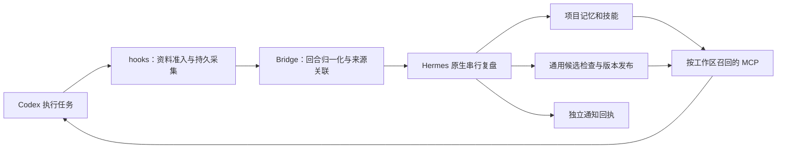

# Codex 与 Hermes 自进化实现（0.4.2）

Codex 完成用户任务；同机、独立数据目录中的 Hermes 从执行证据学习，再通过 Codex hooks 和 MCP 提供项目记忆与经过检查的通用技能。外围版本为 0.4.2，Linux／SSH 与本地 macOS 共用学习核心。原生版本及 Learning API v1 补丁按 [兼容清单](../patches/compatibility.json) 固定，包含 v0.23.0 和 v0.23.1。

## 执行与学习闭环



hooks 不调用模型。`capture.py` 先确定真实 cwd 对应的 Git 根目录／工作目录与宿主来源，再处理资料准入，最后写入 SQLite 事件箱。`normalize.py` 合并工具开始、执行、轮询与回合结束；整数退出码可证明命令终态，自由文本、布尔退出码和未识别结果保留 unknown。迟到结果不会覆盖已记录的中断。

`daemon.py` 把已结束的回合投影到 Hermes Learning API，复用原生触发阈值、review、Memory、Skills 和 Curator。观察、投影和复盘都有持久状态；状态不确定的复盘不能换 ID 盲目重放。技能加载回执只证明某个内容版本交付给了 Codex，实际应用和任务验证需要独立证据。

## 资料准入与流程学习

新建全局配置默认开启 `data_policy.workflow_projection` 与 `checked_publication`。正文未通过配置的评估程序时，仅采集固定动作类别及执行状态。原提示词、代码、工具参数／输出和助手正文不进入这条学习路径。流程关联标识保留在本地，原生复盘使用派生标识。

流程 review 只允许查看其拥有的 `workflow-*` 技能，或用原生 Skills 工具写入这些技能的 Markdown 正文。它排除已有私人记忆、其他技能目录、命令执行和资源文件写入；提示词重建也保留同一边界。完整合同见 [流程学习](./WORKFLOW-METADATA.zh-CN.md)。

这套固定结构不是通用资料分类或脱敏服务。业务正文需要用户配置的 `assessment_command` 明确准入；共享还要求公开分类及共享许可。旧配置保持其既有策略，升级包不会替用户改写已部署的配置。`doctor`、模型探针与业务验证的结果须分别判断。

## 项目归属与通用发布

`knowledge.py` 维护 Memory 条目和 Skills 的来源索引。项目记忆只随匹配的工作区返回。通用技能需要声明 `learning_scope: global_candidate`，并通过来源、路径、内容摘要、凭据和私有标识检查；当前检查不批准任意可执行资源。

`policy.py` 将接受的内容快照绑定到版本。流程复盘的来源凭证绑定实际写入版本和原生回执，后续 Curator 或其他写入者不能继承旧凭证。新候选被拒绝时，上一已发布版本继续可用。未准入正文不会因为技能名称看起来通用而获得共享许可。

## 运行时、适配与更新

`configuration.py` 构造原生 provider 配置，支持显式具名 provider、模型、API 模式、推理档位和会话亲和头。`authentication.py` 区分原生 OAuth 登录与 custom provider 配置状态；配置有效不等于模型调用通过。认证始终由原生 Hermes 管理，不复制根账号 Token。

`updates.py` 发现官方稳定版本、核对精确提交和补丁、准备独立候选并运行固定测试。`adaptation.py` 在显式开启 `updates.auto_adapt` 后，允许 Codex CLI 使用现有模型／provider／策略在私有候选中维护兼容材料。维护作业不能修改验证器、旧版本或原生测试，其自报成功也不能激活候选。每个目标／控制器指纹最多尝试两轮；不确定结果先保留记录。

学习机制重设计和不可逆迁移返回 `plan_required`，普通升级不会自动执行这些方案。`migration.py` 保留原安装改动，逐项记录冲突与遗漏；`site_updates.py` 单独核对适配层和固定回归，机器配置与凭据不进入补丁。Linux gateway 的平滑重启合同只在已配置相应托管服务时使用。

`supervisor.py` 等待当前复盘结束，以暂停学习的方式启动候选，核对实际解释器、API 和召回后再提交切换。启动失败恢复原生数据、来源索引、共享版本及流程技能凭证；事件箱、交付回执和根账号认证保留当前状态。提交后的回退先检查旧运行时与当前数据，不用旧快照覆盖新知识。worker 暂时缺失时，监督进程继续保留更新与恢复入口。

## 通知与验证

`notices.py` 管理独立的持久通知队列，按 scope 查询并为各 consumer 保存 sent／read 状态。通知不进入 MCP 或 hook 的模型上下文。macOS 回执窗口和 SSH 接收器使用相同回执结构，sent 表示系统接受，read 表示明细窗口被打开。

```sh
python3 -B scripts/check_release.py
scripts/bridge --help
scripts/bridge doctor --settings /ABS/pilot/bridge.json --json
scripts/bridge update status --settings /ABS/pilot/bridge.json
```

发布检查运行离线回归、包版本／补丁摘要、历史证据完整性、文档链接及凭据扫描；不会调用模型或安装服务。`probes/real_learning.py`、`probes/workflow_learning.py` 需要独立验证 home 和显式调用，合成模型探针不能替代真实 App hooks、跨聊天应用或桌面可见性验收。各分支的当前离线结果与历史宿主验收分开记录。
