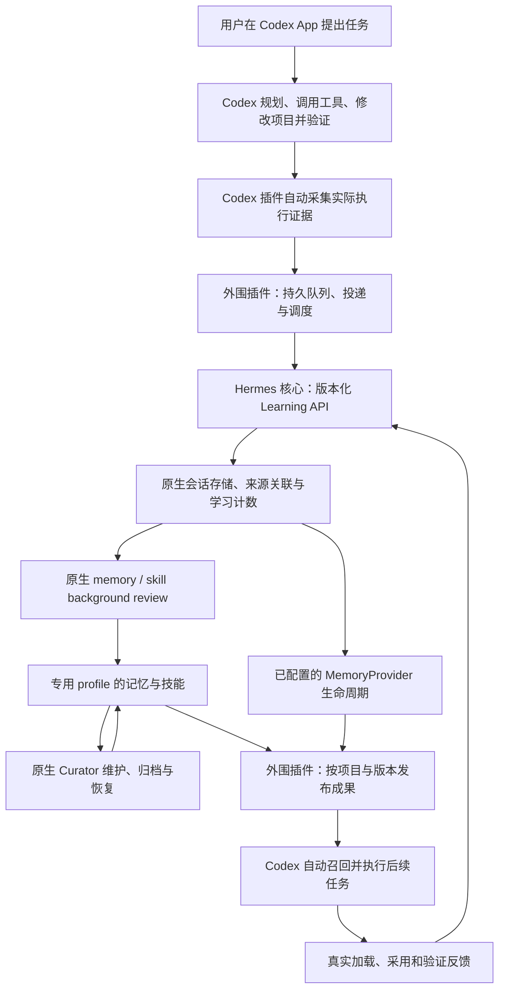

# Codex 执行任务、Hermes 原生自进化：推荐实现方案

2026-11-03 更新。当前约束：**任务与主体交互留在 Codex App，Codex 核心不改；Hermes 改动尽量收敛为一个稳定的学习扩展入口，其余集成放在外围插件。** 优先保持原生学习机制，同时减少升级维护面。原先“双方核心都不改”作为备选条件保留。

**推荐增加一个通用的 Hermes Learning API，配套外围学习桥接插件和 Codex 插件。** 拟新增入口为 `ctx.learning(version=1)`，它封装原生观察会话、计数、复盘、记忆/provider、技能使用和执行收据。Codex 采集适配、原始证据存档、持久任务队列、空闲调度、传输、状态界面及成果发布留在插件。用户照常工作，不必手动要求总结，经验取舍及写入仍由 Hermes 完成。

这是对上一版“较完整的 Hermes 原生学习服务”的进一步收敛：**核心维护学习语义和事实，插件维护集成与任务编排。** 不在核心新增整套 Codex 网关协议、任务管理平台或成果发布系统。一个稳定入口指一个受支持的能力边界，内部可以有多个方法和少量接缝，并不承诺只改一行或一个文件。详细审查见[最小扩展合同](/Users/cy/Dev/agents-dev/hermes-plugin1102/HERMES-CODEX-EXTENSION-REVIEW.md)。

这是一项基于现有代码的扩展方案，尚不是可以直接打开的产品开关。本轮完成研究与文档，未修改 Hermes/Codex 生产源码、配置或服务。历史隔离实验验证过内部部件闭环，未验证本方案的正式服务、桌面安装及真实模型学习效果。

## 为什么这条路线最好

Hermes 已经实现了“Codex 执行 → 轨迹投影 → 原生学习”：官方 `codex_app_server` runtime 让 Hermes 启动 Codex 子进程，把完成的 Codex items 转成原生会话消息，再进行记忆同步和后台复盘。但这个模式的会话主体是 Hermes，不能直接等同于用户原有 Codex App 聊天。[官方 runtime 说明][runtime-doc]

适合复用的是其中的学习机制：`_persist_projected_messages` 负责入库，`_finish_codex_turn` 接上计数、MemoryProvider 和自动复盘。建议将学习相关语义抽成共用组件，同时服务 Hermes 自有 runtime 与新 API。Codex 专属事件映射放外围适配器，以现有 `CodexEventProjector` 作为对照，插件不直接 import 这个私有模块；核心只接受与执行器无关的规范化 `ObservedTurn`。这样保留原生学习，也避免核心跟着 Codex 的事件格式一起改。[现有 projector][projector]、[现有回合完成流程][codex-finish]

Hermes 已有 `ctx.llm`、`ctx.subagent_lifecycle` 这类宿主服务接口；后者使用版本化值对象与可序列化句柄，而不向插件暴露 AIAgent。Learning API 可沿用这种组织方式。现有 subagent API 需要活动父会话、重启后不能恢复运行，因此这里只借鉴接口风格，不把它当现成学习服务。[现有 facade][plugin-facades]、[官方生命周期合同][subagent-api]

| 路线 | 是否符合当前目标 | 主要取舍 |
| --- | --- | --- |
| **Codex 插件 + 外围学习桥接插件 + Hermes Learning API** | **推荐**：Codex 执行，Hermes 独立学习 | 核心只新增通用学习合同与必要内部接缝；集成、任务队列和发布独立升级。 |
| 双方不改，公开 Gateway 学习会话 | 可作回退 | 多一次学习主回合；计数针对学习对话；普通写入与后台写入混合；review 完成状态不充分。 |
| Hermes 主控，调用 Codex runtime | 学习机制接近现有原生路径 | 主体会话转到 Hermes，不满足现有 Codex App 聊天保持执行主体的要求。 |
| 只提供 Hermes MCP 工具或一个总结 skill | 不完整 | 提供能力不等于自动采集、触发、维护和读回。 |
| 外围脚本直接调用私有 review 函数 | 适合隔离可行性探针 | 缺少受支持的生命周期、状态合同和升级保证，不作为长期产品接口。 |

社区候选的代码核对见[方案比较](/Users/cy/Dev/agents-dev/hermes-plugin1102/HERMES-CODEX-OPTIONS.md)。本次查到的 `hermes-codex-learning` 偏向证据和候选文件导出；`Hermes-Codex-Plugin` 是独立记忆实现；`codex-honcho` 有自动记忆闭环，但都没有直接交付本需求的完整 Nous Hermes 学习链路。

## 整体结构



**Codex 插件**处理采集、召回、技能加载和反馈。**外围学习桥接插件**处理适配、原始证据、传输、队列、调度和发布。**Hermes Learning API**拥有原生会话、学习决策、计数、写入保护和真实执行结果。两个插件都不直接写 Hermes DB、不修改原生计数，也不复刻记忆或技能规则。

实际 Codex 聊天的继续、分叉、归档和执行状态仍由 Codex 管理。Hermes 维护与其关联的“外部执行观察会话”，不通过重放原用户请求来重新执行项目任务。

## Codex 端：用现有扩展能力自动采集与读回

采集使用 `UserPromptSubmit`、`PostToolUse`、`Stop`，按需补充压缩、中断及子代理事件。hook 只做短时间本地落盘；独立进程负责投递。`Stop` 是一轮边界，不能当成整个项目任务已经成功。`SessionEnd` 也不是每次切走聊天都会发生。[OpenAI Hooks][hooks]

恢复完整历史时，优先使用实际可连接的 App Server 的只读 thread/turn/items 接口；**不能假定外部进程可以任意连接桌面 App 自己的后端**。目标桌面版本需先验证访问方式。若只能取得 hook 数据，就以它为事实来源；`transcript_path` 是可选且格式不稳定的补充，适配器必须版本化并标注缺失。[App Server][app-server]、[Hooks 输入边界][hooks]

关键约定：

- 使用 host、project、真实 thread ID、turn ID 及可获得的 item/call ID 关联。不能单靠可能被分叉共用的 session 标识；子代理 hook 也可能携带父会话 ID。若来源不提供稳定调用 ID，为实际采集事件保存本地 ID 并在投递重试时复用，不能以内容 hash 将两次相同命令错误合并；与原始历史无法核对时保留覆盖缺口。
- 记录实际用户纠正、工具参数、结果、退出码、最终答复和证据附件；流式片段不累计为多次工具执行。迟到结果与重复 Stop 不产生重复学习。
- 脱敏后保存可追溯的原始证据与覆盖信息；已注入的记忆、插件文本及助手推断不能冒充新的人类偏好。
- `SessionStart` 注入当前作用域的简短记忆；`UserPromptSubmit` 可按任务取相关经验。后台不可用时使用有版本的本地缓存，当前任务继续执行。
- hook 内的异步任务会受 Codex 会话结束影响，不能靠它承载长时间复盘。首次安装仍按 Codex 的正常 hook 信任流程启用，后续任务自动运行。

## 核心入口与外围插件的职责边界

### 1. 外部轨迹接收与原生会话归档

增加明确的外部来源类型，由 Hermes 自己验证、去重、存储和建索引。外部插件提交事实，不直接改写会话数据库。

每个批次至少包括 schema 版本、source host/project/thread/turn、父子/分叉关系、输入范围、完成/失败/中断状态、事件列表、内容 hash、证据附件引用及采集缺口。外围插件负责从宿主事件转换；核心验证规范化输入、保存原生会话并推进学习。保留 Codex 的真实身份；规范化后的 `assistant/tool` 消息是“外部已执行事件的表示”，不表示 Hermes 亲自执行过。

以现有 projector 为映射对照，但不能把它称为无损格式：它对 fileChange 只留路径与类型摘要，对部分工具输出截断，对非文本输入也有信息损失。原始证据保存在插件自己的数据区，通过有界只读证据工具补读；规范化消息保存在 Hermes 原生会话。[具体投影行为][projector]

核心只保留最小受理收据：来源事件 ID、session revision、计数增量和待复盘 intent。它们与原生消息入库必须一致提交，或有明确恢复协议；整个任务队列留在插件。相同 ID 与相同内容重试返回原收据；相同 ID 却内容不同显式处理为冲突或修订。该保证针对受理和计数，不代表所有文件/远端写入恰好执行一次。

### 2. 共享的回合学习生命周期

从现有路径提取“观察到一轮完成之后，如何学习”的共用组件，而不是直接对外暴露 `_finish_codex_turn`。后者假设 `run_conversation` 已推进用户与记忆计数，同时混有 Codex token/compaction 记账，直接调用会漏计或重复计费。[源码中的前置假设][codex-finish]

共享组件至少负责：真实用户回合与工具活动计数、原生触发判断、MemoryProvider 同步与预取、复盘快照、来源和效果归因。Hermes 已有的 Codex runtime 与新入口都调用它；普通 Hermes 回合尽可能共用策略，但原有差异必须通过测试保留，不能为了统一而悄悄改行为。现有 provider 同步与 review 对失败、中断和最终回复的条件不完全相同，不能用一个笼统的 success 标记覆盖全部规则。[普通回合 finalizer][native-finalizer]、[Codex 完成条件][codex-finish]

外部观察会话要有完整的原生学习上下文和 provider 生命周期，但不运行第二遍业务主任务。单独创建一个 review fork 不足以替代 provider 初始化、召回、`sync_all`、预取和真正会话结束清理。[provider 完成流程][provider-sync]

计数优先对齐 **Hermes 现有 Codex runtime 的语义**：每个完成的 tool-shaped item 计一次。它与其他 Hermes runtime 的批量 tool loop 并不天然逐次相等。仅有 hook 摘要时记录映射依据，缺失状态保持未知。

### 3. 插件持久任务与核心复盘结果

保留 `background_review.py` 的原生提示词、模型路由、工具白名单、读后再写保护及写入来源。插件拥有持久 job、队列、预算、重试计划和 UI；核心只负责执行签发的复盘 intent，返回带快照版本的 attempt 收据、真实结果和成本，不复制一套总结提示词和写入引擎。[原生 review 执行][review-fork]

job 的执行状态与写入结果分开：`run_status` 区分 `queued`、`running`、`completed`、`failed`、`interrupted`、`unknown/reconciling`；结果分别列出 `applied[]`、`staged[]`、`uncertain[]` 及产物版本。同一次 review 可能已有成功写入，又产生暂存项，最后失败，不能用互斥标签抹掉部分进度。

输入已接收不等于复盘完成。只有明确成功结束并确认没有变更，才能记为 `no_change`；缺少 summary、空 actions 或缺少 ledger 都不是充分证据，当前原生汇总异常也可能退成空 actions。[原生汇总边界][review-summary]

现有自动 review 是后台线程；新前台 turn 可以取消旧 review，受管本地模型的 idle queue 也不是通用持久队列。观察入口接收下一轮证据时不启动新的业务前台回合。插件负责待执行工作，核心仍判断配置、工具、原生本地 idle 等执行条件，并明确返回 deferred/skipped/running；不能将同一工作同时交给两个互不知情的队列。[原生取消机制][review-cancel]、[原生 idle queue][idle-queue]

同一 profile 的学习写入、Curator 及成果发布需要协调。仅串行插件队列不能阻止原生工具、Curator 或 pending 审批同时改文件，核心需要复用或补足写入协调接缝。首版可限定专用 profile、单学习服务 owner；若其他 writer 尚未协调，就必须明确不支持并发。插件可合并尚未受理的批次，但不能自行篡改核心已签发 intent 的计数、范围或快照。远程 MemoryProvider 不属于本地文件事务。

原生技能变更账本能提供恢复证据，但它是尽力写入的审计，不是事务门禁。即使队列在插件，核心最小 attempt 收据也不能移走：原生写入后、插件保存结果前崩溃，插件无从判断是否已产生效果。已开始但结果不明的工作先核对并标为 unknown/reconciling，不能盲目重跑模型。若 v1 没有完整 mutation receipts，应明示恢复上限。[技能账本边界][skill-ledger]

provider 状态也由核心报告。现有 `sync_all` 是后台排队，返回并不表示远端已保存；状态应区分 enqueued/delivered/failed/unknown。插件不捕捉 provider 对象、不重做初始化/关闭和脱敏规则。[异步 provider 同步][provider-async]

社区 `background-review-watch` 可借鉴状态展示，但它主要轮询日志并估计倒计时，不能替代学习 job 的持久状态与恢复合同。[插件实现说明][review-watch]

### 4. 成果读取、采用反馈与长期维护

Hermes profile 是经验的权威来源。发布器只导出已生效版本，保留技能完整目录中的脚本、references、模板及来源 hash；不能只复制 `SKILL.md` 就假定技能可用。pending 内容不当成生效记忆发布。

让 Hermes 明确知道产物的执行环境是 Codex：经验中的操作由 Codex 工具完成。发布前检查命令、路径、工具依赖和项目范围；需要改写时回到 Hermes 的原生技能更新流程，不让桥接层另行生成一个无人维护的技能分支。

Codex 用现有 skills/MCP/上下文入口读取。真实取用正文应经过原生 `skill_view`，或新增有来源、有幂等保证的原生使用记录接口；如果使用落地副本，则仅在检测到该版本确实被读取后记使用，不能把定期同步当成使用。[原生 skill_view][skill-view]

反馈区分发现、加载、实际采用及验证通过。测试失败或用户纠正作为下一轮证据，不把“加载过”直接当成功。Curator 的过期、归档、恢复继续依据原生规则及真实使用记录，不由插件改写账本或伪造活跃时间。[Curator][curator]

## 自动触发：原生策略与新增策略分开

**持续接收证据是自动且确定的；是否值得写入是 Hermes 的判断。** 不要求每轮都产出记忆或技能。

推荐先保留原生 nudge 作为基础。外围插件负责空闲窗口、预算和优先级；可选的“空闲补充复盘”通过单独声明的 trigger 请求核心签发 intent，不能自行设置原生计数或伪造阈值已达到。聊天一轮完成并进入空闲、存在尚未审阅的新证据时，可以据此触发一次原生无人值守 review。这样短任务也能得到检查机会，用户无须手动总结。

这个补充触发是**新增调度政策**，不是 Hermes 当前默认行为。验收需同时保留仅按原生阈值的基准模式。不要伪造空用户回合、强行把两个阈值都当已达到，或用自动 `/refine` 冒充原生 nudge。

自动复盘始终使用原生 unattended/background-review 语义。`/refine` 的 `explicit=True` 会将复盘标为 attended；两者的 memory 修改保护不同。后台运行的位置本身不能决定写入身份。[原生写入身份][review-fork]

用户已选择专用 profile 的原生自动写入：建议保持 `memory.write_approval=false`、`skills.write_approval=false`，但**不绕开原生保护**。当前无人值守 memory `patch/remove` 即使在上述设置下也会暂存；普通新增及允许的技能更新按原生规则处理。若未来希望这些操作也完全无人值守，那是另一个明确的 Hermes 策略变更，不能算“完全沿用原生”。[memory 暂存规则][memory-gate]

## 与原生自进化的一致性及剩余差异

| 维度 | 推荐方案中的处理 | 是否仍存在差异 |
| --- | --- | --- |
| 学习提示、模型路由、技能与记忆工具 | 直接复用原生引擎 | 可共用实现；配置和模型不同仍会影响结果。 |
| 执行中的即时学习 | 当前主方案以已完成回合的后台学习为主 | 原生 Hermes 主回合也可直接记忆、修正技能并重置 nudge；本方案不自动复刻这种同回合行为与写入身份。 |
| background write origin、保护规则 | 原生无人值守身份，不伪装显式操作 | 可以保留原生语义。 |
| 技能长期维护 | 原生后台创建及 Curator | 采用反馈必须跨 Codex 回传；只发布副本不足以等同。 |
| 用户/工具计数 | 与 Hermes Codex runtime 共享策略 | 外部采集覆盖不足时不能声称计数完整。 |
| MemoryProvider | 正式观察会话拥有生命周期 | recall 结果通过插件进入 Codex；须防止同一原文被多端重复同步。 |
| 任务历史 | 原始证据 + 原生规范化消息 | Codex 与 Hermes 的上下文、工具语义及可见内容仍不同；不要求不可见的内部推理。 |
| 学习调度 | 原生阈值 + 可选空闲补充，持久 job | 恢复能力和补充触发属于新增能力，不是既有默认。 |
| 成果生效 | 通过 Codex 现有入口使用 | 活跃聊天不能保证无缝替换全部历史上下文；按下一回合/新会话刷新验证。 |

因此可以做到的是：**学习决策、写入、保护和维护复用同一套 Hermes 原生代码，外部任务接入成为正式能力。** 不能承诺不同执行主体、不同模型和不同输入下产生逐字相同的学习结果。

原生自进化不只有回合结束后的 review。普通执行循环允许 `memory` / `skill_manage`，相关调用还会重置 nudge。当前主方案主要接管后台学习，因此经验通常在后续回合生效；原生主回合当场修正记忆/技能的行为不会自动获得。若进一步追求即时性，可扩展“增量观察 → Hermes 学习 → Codex 下一安全点召回”，但需要单独定义写入授权与并发语义，不能把无人值守 review 伪装成前台写入来绕过保护。[执行中的学习工具][foreground-learning]、[原生技能修订提示][foreground-guidance]

这里的“完整自进化”指所启用的原生记忆、经验技能、自动复盘、检索/provider、Curator 及使用反馈闭环，不等于模型权重自动训练。可选的外部记忆服务、独立技能优化研究项目或社区 dreaming 插件，需各自启用和验收，不能因连通本服务就视为全部具备。

## 会话、profile 与 Codex 自身 memories

首版用一个项目的专用 profile。profile 是持久知识和权限边界；观察会话按 Codex chat 关联，再按真实任务或主题分段。不要把整个项目永久堆成一条超长学习对话。跨任务经验通过原生持久记忆、技能和检索复用。[Hermes memory 会话边界][memory-doc]

原始 chat/turn ID 永久关联，分段不会让同一旧回合再次计入学习。分叉时继承必要上下文和来源，新增分支独立记录。只对尚未学习的新增证据调度；历史回填、修订、撤回分别处理，不默认重新批准旧结论。

Hermes 不直接写 Codex 自身的 `~/.codex/memories`。Codex 自有记忆遵守当前产品设置与用户授权；Hermes 产物标注来源、范围、时间和版本，由插件只读提供。用户当前指令、仓库规则和新验证证据不能被旧经验覆盖。[Codex memories][codex-memory]

## 一个稳定扩展入口的具体合同

以下均为**待开发接口示意**，本机 v0.22.5 没有 `ctx.learning`。建议新增一个有范围、有版本、只返回数据对象的学习 facade。这里的版本只属于学习合同，不另造 Hermes 全局插件版本号。

```python
learning = ctx.learning(version=1)  # 拟新增；不是可直接运行的现有代码
```

| 主操作 | 核心承诺 | 插件负责 |
| --- | --- | --- |
| `open` | 建立/恢复绑定 profile 的外部观察 scope；初始化原生模型、记忆/provider，返回 opaque handle | Codex chat 与学习 scope 的映射；不能传入任意 HOME、密钥或 AIAgent |
| `observe` | 校验规范化回合，幂等入库、推进原生计数，返回 revision、receipt 和 review intent | 宿主事件转换、原始证据、重传；不传任意工具次数来操纵计数 |
| `run_review` | 消费核心 intent，按原生策略运行，返回 attempt handle 和真实结果 | 队列、预算、执行时间和查询；不能指定私有 prompt、write_origin 或 `explicit=True` |
| `read` | 按明确的 Context/Skill/Receipt/Attempt 请求类型查询，返回有界值对象 | 把结果显示或发布给 Codex；不能执行 SQL 或反射任意内部对象 |
| `record_usage` | 对真实加载去重并调用原生 usage 逻辑，保留外部采用/验证证据 | 采集技能版本及实际读取/使用结果；列表展示、文件同步不算使用 |
| `close` | 区分真实结束、轮换和软释放，报告 provider 未完成工作及清理状态 | 生命周期映射和停止顺序；不能将 close 当作已回滚所有写入 |

`read` 中列出的请求类型仍是实质合同，不能用一个万能方法掩盖接口规模。取消/维护 tick 可作为明确 capability；若提供取消，必须区分请求已接受与实际已停。句柄不包含活的 Agent、DB、Provider、线程或模型 client，不能泄露凭据。接收权限与 scope 绑定，外部材料仍是证据而不是新的系统指令。

**Curator 的启动也要接入原生生命周期。** 它当前由 gateway/TUI/web 等宿主调用 idle 检查，并非构造 AIAgent 就自动开始。新的观察 scope 应挂到宿主维护循环；独立 headless 部署若没有该循环，则在同一学习 facade 提供明确 maintenance capability，仍调用原生 idle/interval 规则。不能周期执行会绕过正常时机检查的命令，再声称调度完全一致。[原生 Curator][curator-source]

**不要求新增核心 HTTP/WebSocket 端点。** 外围 Hermes 插件可以用现有工具或 CLI 注册能力承载独立服务；传输层、认证绑定、MCP 暴露与进程守护由该插件管理。注册 Hermes 工具不等于自动成为 Codex MCP。若支持 `plugins.isolation: host`，新 facade 要接入现有远程 facade 表，调用只跨越序列化值，不穿透宿主对象。[插件入口][plugin-entry]、[现有 host facade 表][plugin-isolation]

原始证据、job DB 和缓存写入插件数据目录，与可替换的安装目录分开。现有 `plugins.plugin_storage` 提供 profile 内的持久数据目录/SQLite；仍需自行定义 job schema、迁移和恢复策略。[插件持久数据][plugin-contract]

| 核心改动类别 | 收敛后的范围 |
| --- | --- |
| 新公共入口与合同模块 | PluginContext 的学习 facade、值对象/错误/capabilities、文档；不依赖 Codex 品牌或具体 event schema |
| 内部学习适配模块 | 封装原生上下文、共享计数与完成策略；仅核心内部引用私有实现 |
| 少量必要接缝 | review 结构化完成结果、最小受理/attempt 收据、provider 状态、usage 和跨 writer 协调/Curator 挂接 |
| 插件框架登记与测试 | 如支持 host isolation，登记序列化 facade；用冻结外部插件夹具验证行为，不只检查符号存在 |
| 移出核心的内容 | Codex 采集与映射、完整 job 队列/调度平台、原始证据、传输端点、UI、成果发布和 Codex 格式适配 |

功能默认关闭、首版专用 profile 单 owner。原生学习提示词、工具规则和 Curator 决策继续走上游实现。核心仍可能涉及多个模块；不能在原型完成前承诺固定文件数或补丁行数。验收标准是插件只依赖这个合同，没有私有 import、计数修改、DB 直写或运行时替换核心方法。

## 实施与验收顺序

1. **先验证目标 Codex App 的采集与读回。** 在隔离项目中确认真实桌面聊天、工具结果、压缩、分叉、恢复和新聊天技能加载。历史 App Server 试验不代替这一步；无法访问完整轨迹时明确覆盖范围。
2. **提取共享学习生命周期。** 用现有 Hermes Codex runtime 作为对照，固定计数、provider、原生提示与写入保护行为；新增入口先支持一轮完整文本/工具证据。无需先产品化“公开学习主回合”这条过渡路线。
3. **接入插件队列、核心最小收据和原生反馈。** 验证重复提交、迟到工具结果、进程重启、部分写入后失败、无变更、原生暂存、并发与分叉，不把 accepted 当 completed。检查 Curator 维护循环确实被激活。
4. **接通真实后续任务并做对照。** 让 Codex 在不再提示旧经验的条件下正确使用新记忆/技能；对比无经验环境，检查成功、纠正、重复噪声、过期经验及 Curator 归档/恢复。记录真实模型成本与质量后再扩大项目范围。

验收重点是任务改善与原生行为，不是技能数量。至少报告证据覆盖率、入队到复盘完成延迟、原生写入/暂存/无变更结果、经验实际采用及成功率、错误经验传播、token 与缓存情况。

观察会话应以**专用 Hermes profile 配置的学习模型**建立原生父上下文，把模型身份、路由配置版本及凭据引用记录到 job，不将密钥写入证据。现有 `auto` 意为跟随 Hermes 父 agent 的运行时；外部 Codex 的来源模型只是元数据，不代表自动获得它的凭据、端点或缓存。[原生模型解析][review-runtime]

直接复盘能省去额外的学习主回合，但不能保证总 token 更低：外部 Codex App 的模型缓存未必能供 Hermes 使用。在上述学习上下文中保持原生模型路由，换辅助模型会触发不同的历史摘要路径；成本与证据细节需要实测权衡。[review 模型与输入路径][review-fork]

## 是否改源码，以及两端如何升级

**仍需修改 Hermes 源码，但收敛为一个学习扩展面的补丁组；Codex 核心不改。** 外部观察语义、共享学习生命周期、结构化结果和最小收据不是当前 v0.22.5 已有开关；大部分集成与持久 job 编排已移到插件。纯公开接口备选可以不改 Hermes，但要接受此前列出的学习差异。

实现分成可独立升级的三部分：Codex 插件、外围学习桥接插件、Hermes Learning API 补丁。Codex 更新主要改采集/读回适配器；桥接功能迭代主要发插件版本；Hermes 更新主要核对学习 facade 的内部适配和原生行为回归。两端只通过版本化数据合同连接，不同时重做整套集成。

新增合同应遵循上游插件的增量兼容方向：可选字段增加、不改变旧字段含义、破坏性变更提供迁移与兼容窗口；学习 schema/policy/capabilities 分开记录。现有官方插件合同已有这种规则，但 **我们新加的 Learning API 在被上游正式接受之前，仍由我们自己维护兼容性**。入口名字不变不能代替行为测试。[官方插件兼容合同][plugin-contract]

| 更新对象 | 建议维护流程 | 不兼容时的行为 |
| --- | --- | --- |
| Codex App | 按官方方式更新；验证当前宿主的 hooks、工具结果、会话身份、经验注入和技能加载。调整 Codex 适配器，而非修改 App。 | 继续用户任务；对仍可采集的证据入队，对采集失败明确记录缺口。停止不兼容的学习发布，保留有效的旧成果版本。 |
| Hermes | 以官方稳定版固定提交为基线，维护独立的学习 API 补丁组；候选环境主要验证其内部接缝与原生行为，再切换服务。 | 保持已验证版本，不默默丢掉 API 补丁。新原生行为经适配和验收后才进入日用版本。 |
| 桥接协议/插件 | 使用协议版本、能力握手和兼容矩阵；新字段向后兼容，破坏性变更显式升级。支持两端分批升级。 | 保留输入和终态回执；协议不匹配返回明确状态，不宣称已学习或降级成另一种学习语义。 |
| 会话库、记忆、技能、队列 | 数据与代码分离；升级前保存一致性快照，迁移有版本和校验；记录 pending/部分写入。 | 回退同时考虑数据格式兼容；仅回退 Git 或替换应用不能保证已迁移数据库可由旧程序读取。 |

Codex 官方明确 transcript 文件不是稳定接口，因此不应让主链路只依赖解析内部 JSONL。插件脚本更新后，hook 也可能需要重新信任；这是正常宿主升级边界，不是每次任务都需要手动总结。[Codex Hooks 升级相关边界][hooks]

Hermes 官方升级支持自定义分支的 `updates.parked_branch_strategy: update_in_place`，但它描述的是向自定义分支合并 `origin/main`。这不等于本方案推荐的“固定稳定 Release → 候选验证 → 发布定制学习服务”。默认升级还可能切离干净的功能分支，所以不能假定点击官方更新就一定继续运行我们的定制功能。[官方更新规则][hermes-updating]

本机已有的 `/Users/cy/Dev/hermes-stable-custom` 使用官方 pin、`source.patch_commits` 和候选验证流程；本轮只读核对了维护文档与 manifest。可沿用这一维护思路承载新增后端功能，但需要补充学习服务、数据迁移和后台行为的测试清单，不能将现有维护回执当作本功能已验收。[现有维护合同](/Users/cy/Dev/hermes-stable-custom/personal/STABLE_CUSTOM.md:5)

每次升级至少验证：采集与幂等、原生触发及写入保护、进程恢复、技能实际读回与使用反馈、Curator 行为、模型路由、历史数据迁移。原生学习提示词和工具继续调用上游实现，合入新版后可随之获得改进，但仍需检查行为变化。**没有可靠依据承诺零维护或每次自动合并无冲突。** 长期应争取将通用外部观察/学习入口提交上游；只有上游真正提供等价能力并通过对照验收，才移除对应定制补丁。

## 已有证据与文档关系

- [原始源码研究与隔离实验](/Users/cy/Dev/agents-dev/hermes-plugin1102/HERMES-CODEX-RESEARCH.md)：真实桌面附带 App Server、真实命令、临时 profile、脚本模型，验证过自动投递到内部复盘及新聊天读取。不是桌面 GUI 和真实模型效果验收。
- [实验原始收据](/Users/cy/Dev/agents-dev/hermes-plugin1102/HERMES-CODEX-PROBE.json)：保留不变，Hermes 业务主回合模型调用为 0；内部复盘调用为 3；这组数字仅适用于该合成试件。
- [纯公开接口边界](/Users/cy/Dev/agents-dev/hermes-plugin1102/HERMES-CODEX-NATIVE-PARITY.md)：作为不改 Hermes 时的回退参考，不再是当前最优路线的限制条件。
- [最新路线与社区方案比较](/Users/cy/Dev/agents-dev/hermes-plugin1102/HERMES-CODEX-OPTIONS.md)：列出社区项目核对提交、代码证据和取舍。
- [最小学习扩展合同审查](/Users/cy/Dev/agents-dev/hermes-plugin1102/HERMES-CODEX-EXTENSION-REVIEW.md)：本次收敛的核心/插件职责、值合同、幂等与崩溃边界。

源码基线为本机干净的 Hermes `v0.22.5` / `bf0203a794a07aac3ff764972ab9087baa4e4f4e`；实验 Codex 为桌面附带 CLI `0.166.0-alpha.5.1`。下列 Hermes 源码链接固定提交；在线产品文档反映查阅时页面，不是对其他版本的兼容承诺。

[runtime-doc]: https://hermes-agent.nousresearch.com/docs/user-guide/features/codex-app-server-runtime
[projector]: https://github.com/NousResearch/hermes-agent/blob/bf0203a794a07aac3ff764972ab9087baa4e4f4e/agent/transports/codex_event_projector.py#L48
[codex-finish]: https://github.com/NousResearch/hermes-agent/blob/bf0203a794a07aac3ff764972ab9087baa4e4f4e/agent/codex_runtime.py#L666
[native-finalizer]: https://github.com/NousResearch/hermes-agent/blob/bf0203a794a07aac3ff764972ab9087baa4e4f4e/agent/turn_finalizer.py#L763
[foreground-learning]: https://github.com/NousResearch/hermes-agent/blob/bf0203a794a07aac3ff764972ab9087baa4e4f4e/agent/tool_executor.py#L746
[foreground-guidance]: https://github.com/NousResearch/hermes-agent/blob/bf0203a794a07aac3ff764972ab9087baa4e4f4e/agent/prompt_builder.py#L259
[provider-sync]: https://github.com/NousResearch/hermes-agent/blob/bf0203a794a07aac3ff764972ab9087baa4e4f4e/run_agent.py#L892
[review-fork]: https://github.com/NousResearch/hermes-agent/blob/bf0203a794a07aac3ff764972ab9087baa4e4f4e/agent/background_review.py#L1149
[review-runtime]: https://github.com/NousResearch/hermes-agent/blob/bf0203a794a07aac3ff764972ab9087baa4e4f4e/agent/background_review.py#L253
[review-summary]: https://github.com/NousResearch/hermes-agent/blob/bf0203a794a07aac3ff764972ab9087baa4e4f4e/agent/background_review.py#L1259
[review-cancel]: https://github.com/NousResearch/hermes-agent/blob/bf0203a794a07aac3ff764972ab9087baa4e4f4e/agent/background_review.py#L129
[idle-queue]: https://github.com/NousResearch/hermes-agent/blob/bf0203a794a07aac3ff764972ab9087baa4e4f4e/agent/review_idle_queue.py#L1
[memory-gate]: https://github.com/NousResearch/hermes-agent/blob/bf0203a794a07aac3ff764972ab9087baa4e4f4e/tools/memory_tool.py#L179
[skill-ledger]: https://github.com/NousResearch/hermes-agent/blob/bf0203a794a07aac3ff764972ab9087baa4e4f4e/tools/skill_ledger.py#L1
[skill-view]: https://github.com/NousResearch/hermes-agent/blob/bf0203a794a07aac3ff764972ab9087baa4e4f4e/tools/skills_tool.py#L737
[review-watch]: https://github.com/vectorforge22/background-review-watch/blob/75c6f45741021529e19f87bbf2803ea1b608aa5e/README.md
[curator]: https://hermes-agent.nousresearch.com/docs/user-guide/features/curator
[memory-doc]: https://hermes-agent.nousresearch.com/docs/user-guide/features/memory
[hooks]: https://learn.chatgpt.com/docs/hooks
[app-server]: https://learn.chatgpt.com/docs/app-server
[codex-memory]: https://learn.chatgpt.com/docs/customization/memories
[hermes-updating]: https://hermes-agent.nousresearch.com/docs/getting-started/updating
[plugin-facades]: https://github.com/NousResearch/hermes-agent/blob/bf0203a794a07aac3ff764972ab9087baa4e4f4e/hermes_cli/plugins.py#L376
[plugin-entry]: https://github.com/NousResearch/hermes-agent/blob/bf0203a794a07aac3ff764972ab9087baa4e4f4e/hermes_cli/plugins.py#L643
[plugin-isolation]: https://github.com/NousResearch/hermes-agent/blob/bf0203a794a07aac3ff764972ab9087baa4e4f4e/hermes_cli/plugin_isolation.py#L52
[subagent-api]: https://hermes-agent.nousresearch.com/docs/developer-guide/subagent-lifecycle-api
[plugin-contract]: https://hermes-agent.nousresearch.com/docs/developer-guide/plugins
[provider-async]: https://github.com/NousResearch/hermes-agent/blob/bf0203a794a07aac3ff764972ab9087baa4e4f4e/agent/memory_manager.py#L441
[curator-source]: https://github.com/NousResearch/hermes-agent/blob/bf0203a794a07aac3ff764972ab9087baa4e4f4e/agent/curator.py#L1198
